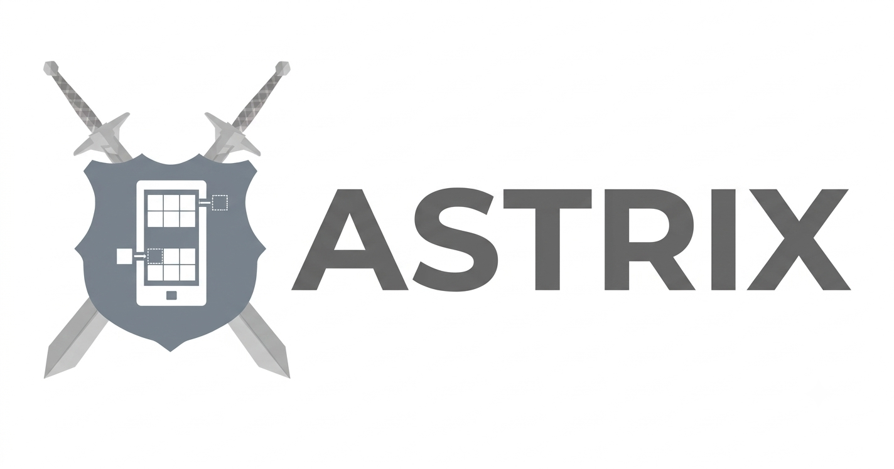
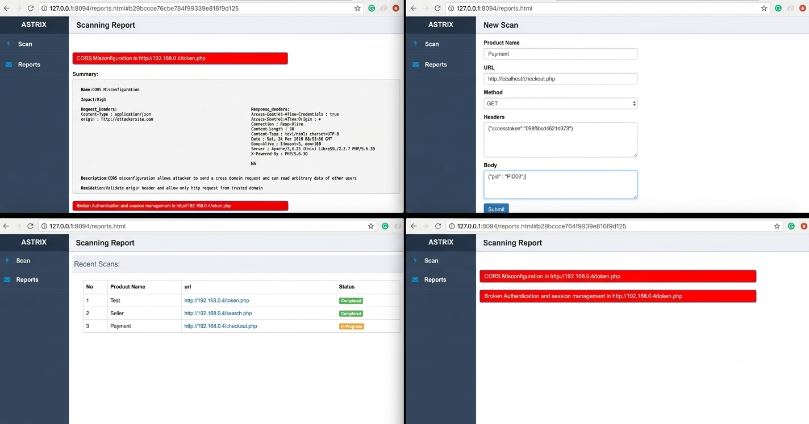

## Astrix


REST API penetration testing is complex due to continuous changes in existing APIs and newly added APIs. Astrix can be used by security engineers or developers as an integral part of their process, so they can detect and patch vulnerabilities early during the development cycle. Astrix can automatically detect and test login & logout (Authentication API), so it's easy for anyone to integrate this into a CI/CD pipeline. Astrix can take an API collection as an input so this can also be used for testing APIs in standalone mode.

- SQL injection
- Cross site scripting
- Information Leakage
- Broken Authentication and session management
- CSRF (including Blind CSRF)
- Rate limit
- CORS misconfiguration (including CORS bypass techniques)
- JWT attack
- CRLF detection
- Blind XXE injection 
- Server-side Request Forgery
- Template Injection


## Requirement
- Linux or MacOS
- Python 3.7+
- MongoDB
- Celery
- RabbitMQ

## Installation on local machine

```bash
$ git clone [repo-link]

$ cd Astrix
$ sudo pip install -r requirements.txt
$ sudo rabbitmq-server
$ celery -A celery_app worker
$ cd API
$ python3 api.py
```

## Docker Installation

### Run Mongo Container:

```bash
$ docker pull mongo
$ docker run --name astrix-mongo -d mongo
```

### Installing GUI Docker: 

```bash
$ git clone [repo-link]
$ cd Astrix
$ docker build -t astrix .
$ docker run -it -d --link astrix-mongo:mongo -p 8094:8094 astrix
$ docker exec -it CONTAINER_ID /bin/bash
$ cd /app
$ ./start_server.sh
$ ENTER and exit
```

### Check Container Logs:

```bash
$ docker logs CONTAINER_ID
```

### Installing CLI Docker:

```bash
$ git clone [repo-link]
$ cd Astrix
$ docker build -t astrix-cli .
$ docker run --rm -it --link astrix-mongo:mongo astrix-cli 
```

## Dependencies

```text
- requests
- logger
- pymongo
- ConfigParser
- pyjwt
- flask
- sqlmap
- celery
```

## Usage: CLI

```text
$ python astrix.py --help

        /\        | |       (_)
       /  \   ___ | |_ _ __  ___  __
      / /\ \ / __|| __| '__|| \ \/ /
     / ____ \\__ \| |_| |   | |>  <
    /_/    \_\___/ \__|_|   |_/_/\_\


usage: astrix.py [-h] [-c {Postman,Swagger}] [-n COLLECTION_NAME] [-u URL]
                 [-headers HEADERS] [-method {GET,POST}] [-b BODY]
                 [-l LOGINURL] [-H LOGINHEADERS] [-d LOGINDATA]

REST API Security Testing Framework

optional arguments:
  -h, --help            show this help message and exit
  -c {Postman,Swagger}, --collection_type {Postman,Swagger}
                        Type of API collection
  -n COLLECTION_NAME, --collection_name COLLECTION_NAME
                        Name of API collection
  -u URL, --url URL     URL of target API
  -headers HEADERS, --headers HEADERS
                        Custom headers. Example: {"token" : "123"}
  -method {GET,POST}, --method {GET,POST}
                        HTTP request method
  -b BODY, --body BODY  Request body of API
  -l LOGINURL, --loginurl LOGINURL
                        URL of login API
  -H LOGINHEADERS, --loginheaders LOGINHEADERS
                        Headers should be in a dictionary format. Example:
                        {"accesstoken" : "axzvbqdadf"}
  -d LOGINDATA, --logindata LOGINDATA
                        Login data of API
```

## Usage: Web interface
Run `api.py` and access the web interface at `http://127.0.0.1:8094`
```bash
$ cd API
$ python api.py
```

NOTE:
On macOS 10.13+ you must use the flag `OBJC_DISABLE_INITIALIZE_FORK_SAFETY=YES` to prevent scanning processes from being killed due to the way `fork()` and `exec()` has been changed. See [here](http://www.sealiesoftware.com/blog/archive/2017/6/5/Objective-C_and_fork_in_macOS_1013.html) for more information.
```bash
$ cd API
$ OBJC_DISABLE_INITIALIZE_FORK_SAFETY=YES python api.py
```

## Screenshots 
### New scan


### Scan Reports



### Detailed Report

